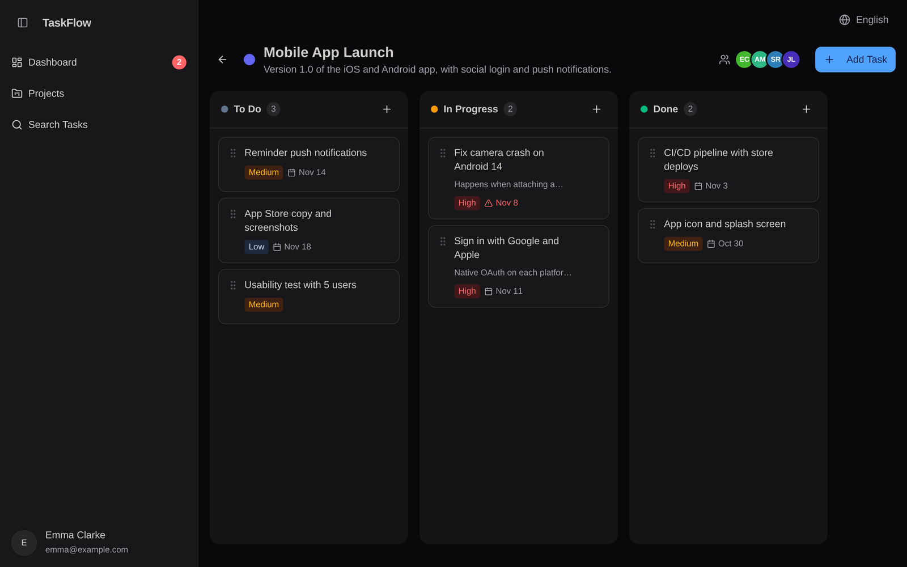

# TaskFlow Board

A clean, focused Kanban task management app built with React, tRPC and Turso (libSQL).

**[Try the live demo](https://taskflow-board.a-barros.uk/demo)**: no sign-up, you land on a ready-made board in a few seconds ([versão em português](https://taskflow-board.a-barros.uk/demo?lng=pt-BR)).



## Features

- **Kanban board**: drag and drop tasks between To Do, In Progress and Done, with instant (optimistic) updates
- **Tasks**: title, description, priority, due date (timezone-safe), assignee and comments
- **Projects and members**: custom colors, invite teammates by email, owner-only management
- **Search and filters**: by title, status, priority, project and overdue
- **Dashboard**: totals by status and overdue alerts
- **Demo mode**: each visitor gets an isolated, pre-filled workspace that expires after 24 hours
- **Security**: per-project authorization on every API call, rate-limited auth, httpOnly `SameSite=Lax` session cookies
- **i18n**: English and Brazilian Portuguese (`?lng=en` / `?lng=pt-BR` in any URL)

## Tech Stack

| Layer | Technology | Version |
|---|---|---|
| **Frontend Framework** | React, TypeScript | React 19.2, TS 5.9 |
| **Build & Dev** | Vite, esbuild | Vite 7.1, esbuild 0.25 |
| **Styling** | TailwindCSS, Radix UI, shadcn/ui | TailwindCSS 4.1, Radix UI latest |
| **UI Components** | Lucide React (icons), Embla Carousel, Sonner (toast), Recharts | Latest |
| **Backend** | Node.js, Express, tRPC | Express 4.21, tRPC 11.6 |
| **Database** | Turso (LibSQL), Drizzle ORM | @libsql/client 0.17, Drizzle 0.45 |
| **Form & Validation** | React Hook Form, Zod | 7.64, 4.1 |
| **Query Management** | TanStack React Query | 5.90 |
| **Routing** | Wouter (lightweight router) | 3.3.5 |
| **Drag & Drop** | @dnd-kit | 6.3 (core), 10.0 (sortable) |
| **i18n** | i18next, react-i18next | 25.10, 16.6 |
| **Auth** | Jose (JWT), bcryptjs | 6.1, 3.0 |
| **Testing** | Vitest | 2.1 |
| **Linting** | ESLint, Prettier, TypeScript | ESLint 10.1, Prettier 3.6 |

## Getting Started

### Prerequisites

- Node.js 22.12+
- pnpm

#### Installing pnpm

If you don't have pnpm installed, you can install it globally:

```bash
# Using npm
npm install -g pnpm

# Using Homebrew (macOS)
brew install pnpm

# Using Scoop (Windows)
scoop install pnpm

# Using yarn
yarn global add pnpm
```

Verify the installation:

```bash
pnpm --version
```

### Installation

```bash
pnpm install
```

### Database Setup

```bash
# Run migrations to create SQLite tables
pnpm db:migrate
```

### Development

```bash
pnpm dev
```

The app will be available at `http://localhost:3000`.

### Testing

```bash
pnpm test           # Vitest: authorization, demo mode, auth and date rules
pnpm check          # TypeScript, including the same check Vercel runs on api/
```

### Build

```bash
pnpm build
```

## Project Structure

```
client/
  src/
    pages/          # Route-level pages (Dashboard, Projects, ProjectDetail, TaskSearch)
    components/     # Reusable components (TaskCard, TaskModal, DashboardLayout)
    lib/trpc.ts     # tRPC client binding
    App.tsx         # Routes & layout
drizzle/
  schema.ts         # Database schema (users, projects, tasks, comments)
  migrations/       # SQL migration files
server/
  db.ts             # SQLite query helpers
  routers.ts        # tRPC procedures (projects, tasks, comments, dashboard)
scripts/
  migrate.mjs       # Database migration runner
```

## Database

**Architecture:** Turso (LibSQL) with Drizzle ORM for data access layer and migrations.

### Schema

```
users       — id, openId, name, email, role, ...
projects    — id, name, description, color, ownerId, ...
tasks       — id, title, description, status, priority, dueDate, position, projectId, ...
comments    — id, content, taskId, authorId, ...
```

## Deployment

**Database:** This project uses Turso (managed LibSQL), so there's no need to manage SQLite files in production.

Deploy to serverless platforms:

- **Vercel** — Connect to Turso database, deploy as Vercel Functions
- **Railway** — Easy database connection via environment variables
- **Fly.io** — Deploy container with env vars pointing to Turso
- **Render** — Similar to Railway, supports serverless Node deployments

**Environment Setup:**
Ensure `TURSO_DATABASE_URL` and `TURSO_AUTH_TOKEN` are configured in your deployment platform.

## License

MIT
